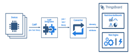

+++
title = "CoAP Integration"
description = "CoAP Integration Guide"

[extra]
status = "imported"
checked = ""
source = "docs/user-guide/integrations/coap.md"
+++
<div class="st-callout info"><p class="st-callout-title">SENTIENT Professional Edition feature</p>


Only **Professional Edition** supports **Platform Integrations** feature.<br>
Use **SENTIENT Cloud** or [**install**](/docs/installation/) your own platform instance.


</div>

## Overview

CoAP Integration allows to stream data from devices that use a CoAP protocol to connect to SENTIENT and converts payloads of these devices into the SENTIENT format.

Please review the integration diagram to learn more.



## Prerequisites

In this tutorial, we will show you how CoAP integration works as part of **tb-core** service with **NO SECURE** security mode selected. In order to do this we will use: 


- The instance of [SENTIENT Professional Edition](https://sentient.invenia.in/docs/user-guide/install/pe/installation-options/) installed locally;
- [coap-client](https://manpages.ubuntu.com/manpages/focal/man5/coap-client.5.html) utility which is intended to simulate CoAP client that will connect to CoAP integration;


Let's assume that we have a sensor which is sending current temperature and humidity readings. Our sensor device **SN-001** publishes it's temperature and humidity readings to CoAP Integration on **coap://localhost** URL.


For demo purposes we assume that our device is smart enough to send data in 3 different payload types:
- **Text** - in this case payload is:

```
SN-001,default,temperature,25.7,humidity,69
```

- **JSON** - in this case payload is:

```json
{
  "deviceName": "SN-001",
  "deviceType": "default",
  "temperature": 25.7,
  "humidity": 69
}
```

- **Binary** - in this case, the payload looks like this (in HEX string):

```
\x53\x4e\x2d\x30\x30\x31\x64\x65\x66\x61\x75\x6c\x74\x32\x35\x2e\x37\x36\x39
```

Here is the description of the bytes in this payload:
- **0-5** bytes - **\x53\x4e\x2d\x30\x30\x31** - device name. If we convert it to text - **SN-001**;
- **6-12** bytes - **\x64\x65\x66\x61\x75\x6c\x74** - device type. If we convert it to text - **default**;
- **13-16** bytes - **\x32\x35\x2e\x37** - temperature telemetry. If we convert it to text - **25.7**;
- **17-18** bytes - **\x36\x39** - humidity telemetry. If we convert it to text - **69**;

You can use payload type based on your device capabilities and business cases.

## Uplink Converter

Before setting up an **CoAP integration**, you need to create an **Uplink Converter** that is a script for parsing and transforming the data received by CoAP integration to format that SENTIENT uses. **deviceName** and **deviceType** are required, while attributes and telemetry are optional. attributes and telemetry are flat key-value objects. Nested objects are not supported.

To create an **Uplink Converter** go to **Data Converters** section and Click **Add new data converter —> Create new converter**.
Name it **"CoAP Uplink Converter"** and select type **Uplink**. Use debug mode for now.

<b><font size="3">Debug mode</font></b>

Enabling debug mode allows you to track events, states, and potential errors related to the execution of integrations. This greatly simplifies development and troubleshooting.


<div class="st-callout info">


**Note:** Debug mode can quickly increase disk usage because all debug events are stored in the database.
Starting from **SENTIENT 3.9**, the platform stores the full set of debug events only during the first **15 minutes** after the integrations is created; afterward, only error events are retained.


</div>


Debug mode settings can be combined or disabled entirely.

**Choose device payload type to for decoder configuration:**

- **Text payload**

> One can use either [TBEL](/docs/user-guide/rhai/) (SENTIENT expression language) or JavaScript to develop user defined functions. 
We recommend utilizing [TBEL](/docs/user-guide/rhai/) as it's execution in SENTIENT is much more efficient compared to JS.


<div class="st-tabs">

<div class="st-tab" data-label="TBELRecommended">

Now copy & paste the following script to the Decoder function section:

```javascript
/** Decoder **/

// decode payload to string
var strArray = decodeToString(payload);
var payloadArray = strArray.replaceAll("\"", "").split(',');

var telemetryPayload = {};
for (var i = 2; i < payloadArray.length; i = i + 2) {
    var telemetryKey = payloadArray[i];
    var telemetryValue = parseFloat(payloadArray[i + 1]);
    telemetryPayload[telemetryKey] = telemetryValue;
}

// Result object with device attributes/telemetry data
var result = {
    deviceName: payloadArray[0],
    deviceType: payloadArray[1],
    telemetry: telemetryPayload,
    attributes: {}
  };

/** Helper functions 'decodeToString' and 'decodeToJson' are already built-in **/

return result;
``` 


</div>

<div class="st-tab" data-label="JavaScript">

Now copy & paste the following script to the Decoder function section:

```javascript
/** Decoder **/

// decode payload to string
var strArray = decodeToString(payload);
var payloadArray = strArray.replace(/\"/g, "").replace(/\s/g, "").replace(/\\n/g, "").split(',');

var telemetryPayload = {};
for (var i = 2; i < payloadArray.length; i = i + 2) {
    var telemetryKey = payloadArray[i];
    var telemetryValue = parseFloat(payloadArray[i + 1]);
    telemetryPayload[telemetryKey] = telemetryValue;
}

// Result object with device attributes/telemetry data
var result = {
    deviceName: payloadArray[0],
    deviceType: payloadArray[1],
    telemetry: telemetryPayload,
    attributes: {}
  };

/** Helper functions **/

function decodeToString(payload) {
   return String.fromCharCode.apply(String, payload);
}
return result;

``` 


</div>

</div>


- **JSON payload**

> One can use either [TBEL](/docs/user-guide/rhai/) (SENTIENT expression language) or JavaScript to develop user defined functions. 
We recommend utilizing [TBEL](/docs/user-guide/rhai/) as it's execution in SENTIENT is much more efficient compared to JS.


<div class="st-tabs">

<div class="st-tab" data-label="TBELRecommended">

Now copy & paste the following script to the Decoder function section:

```javascript
/** Decoder **/

// decode payload to JSON
var data = decodeToJson(payload);

// Result object with device/asset attributes/telemetry data

var deviceName = data.deviceName;
var deviceType = data.deviceType;
var result = {
   deviceName: deviceName,
   deviceType: deviceType,
   attributes: {},
   telemetry: {
       temperature: data.temperature,
       humidity: data.humidity
   }
};

/** Helper functions 'decodeToString' and 'decodeToJson' are already built-in **/

return result;
``` 


</div>

<div class="st-tab" data-label="JavaScript">

Now copy & paste the following script to the Decoder function section:

```javascript
/** Decoder **/

// decode payload to JSON
var data = decodeToJson(payload);

// Result object with device/asset attributes/telemetry data

var deviceName = data.deviceName;
var deviceType = data.deviceType;
var result = {
   deviceName: deviceName,
   deviceType: deviceType,
   attributes: {},
   telemetry: {
       temperature: data.temperature,
       humidity: data.humidity
   }
};

/** Helper functions **/

function decodeToString(payload) {
   return String.fromCharCode.apply(String, payload);
}

function decodeToJson(payload) {
   // covert payload to string.
   var str = decodeToString(payload);

   // parse string to JSON
   var data = JSON.parse(str);
   return data;
}

return result;
``` 


</div>

</div>


- **Binary payload**


<div class="st-tabs">

<div class="st-tab" data-label="TBELRecommended">

Now copy & paste the following script to the Decoder function section:

```javascript
/** Decoder **/

// decode payload to string
var payloadStr = decodeToString(payload);

// decode payload to JSON
// var data = decodeToJson(payload);

var deviceName = payloadStr.substring(0,6);
var deviceType = payloadStr.substring(6,13);

// Result object with device/asset attributes/telemetry data
var result = {
   deviceName: deviceName,
   deviceType: deviceType,
   attributes: {},
   telemetry: {
       temperature: parseFloat(payloadStr.substring(13,17)),
       humidity: parseFloat(payloadStr.substring(17,19))
   }
};

/** Helper functions 'decodeToString' and 'decodeToJson' are already built-in **/

return result;
``` 


</div>

<div class="st-tab" data-label="JavaScript">

Now copy & paste the following script to the Decoder function section:

```javascript
/** Decoder **/

// decode payload to string
var payloadStr = decodeToString(payload);

// decode payload to JSON
// var data = decodeToJson(payload);

var deviceName = payloadStr.substring(0,6);
var deviceType = payloadStr.substring(6,13);

// Result object with device/asset attributes/telemetry data
var result = {
   deviceName: deviceName,
   deviceType: deviceType,
   attributes: {},
   telemetry: {
       temperature: parseFloat(payloadStr.substring(13,17)),
       humidity: parseFloat(payloadStr.substring(17,19))
   }
};

/** Helper functions **/

function decodeToString(payload) {
   return String.fromCharCode.apply(String, payload);
}

function decodeToJson(payload) {
   // covert payload to string.
   var str = decodeToString(payload);

   // parse string to JSON
   var data = JSON.parse(str);
   return data;
}

return result;
``` 


</div>

</div>


## CoAP Integration Setup


1. Go to Integrations section and click Add new integration button. Name it CoAP Integration, select type COAP.

1. Add recently created CoAP Uplink Converter.

1. Copy CoAP endpoint URL - we will use it later in coap-client for testing CoAP Integration. Click "Add" to create an integration.


<div class="st-gallery"><figure><figcaption>Go to Integrations section and click Add new integration button. Name it CoAP Integration, select type COAP.</figcaption></figure><figure><figcaption>Add recently created CoAP Uplink Converter.</figcaption></figure><figure><figcaption>Copy CoAP endpoint URL - we will use it later in coap-client for testing CoAP Integration. Click "Add" to create an integration.</figcaption></figure></div>


### CoAP Integration Configuration

CoAP Integration allows us to choose a security mode:

- **NO SECURE(default mode)**
- **DTLS**
- **MIXED**


For the last 2 types, before creating integration, DTLS support should be enabled in the .yml configuration file or should be updated by overriding the next environment variables in the .conf file:

```
# Enable/disable DTLS 1.2 support
export COAP_DTLS_ENABLED=true
# Default CoAP DTLS bind port
export COAP_DTLS_BIND_PORT=5484 
# Path to the key store that holds the SSL certificate
export COAP_DTLS_KEY_STORE=coapserver.jks 
# Password used to access the key store
export COAP_DTLS_KEY_STORE_PASSWORD=server_ks_password
# Password used to access the key
export COAP_DTLS_KEY_PASSWORD=server_key_password
# Key alias
export COAP_DTLS_KEY_ALIAS=serveralias
# Skip certificate validity check for client certificates
export TB_COAP_X509_DTLS_SKIP_VALIDITY_CHECK_FOR_CLIENT_CERT=false
```

Please, note, that added above environment variables use default DTLS configuration settings. In order to get the CoAP server launched correctly in the DTLS mode, you need to update at least key store settings. Please refer to the [CoAP over DTLS](/docs/user-guide/coap-over-dtls/) guide in order to learn more about the CoAP DTLS configuration.


In addition, CoAP integration will provide us automatically generated CoAP endpoint URL for data transmitting based on the Base URL path and next path prefixes:
- **/i** - Integration resource in the CoAP server
- **/$INTEGRATION_ROUTING_KEY** - autogenerated integration routing key


## Send Uplink message

Once CoAP Integration has been created, the CoAP server register appropriate resources, and then it waits for data from the devices.

Choose device payload type to send uplink message


<div class="st-tabs">

<div class="st-tab" data-label="Text payload">


Use this command to send the message to the CoAP server that is hosted on **localhost**. Replace **$YOUR_COAP_ENDPOINT_URL** with corresponding values.


```bash
echo -e 'SN-001,default,temperature,25.7,humidity,69' | coap-client -m post $YOUR_COAP_ENDPOINT_URL -t text/plain -f-
```


</div>

<div class="st-tab" data-label="JSON payload">


Use this command to send the message to the CoAP server that is hosted on **localhost**. Replace **$YOUR_COAP_ENDPOINT_URL** with corresponding values.


```bash
echo -e -n '{"deviceName": "SN-001", "deviceType": "default", "temperature": 25.7, "humidity": 69}' | coap-client -m post $YOUR_COAP_ENDPOINT_URL -t application/json -f-
```


</div>

<div class="st-tab" data-label="Binary payload">


Use this command to send the message to the CoAP server that is hosted on **localhost**. Replace **$YOUR_COAP_ENDPOINT_URL** with corresponding values.


```bash
echo -e -n '\x53\x4e\x2d\x30\x30\x31\x64\x65\x66\x61\x75\x6c\x74\x32\x35\x2e\x37\x36\x39' | coap-client -m post $YOUR_COAP_ENDPOINT_URL -t application/octet-stream -f-
```


</div>

</div>


Once the command will send you can go to **Device groups** -> **All** you should find an **SN-001** device provisioned by the Integration. 
Click on the device, go to the **Latest Telemetry** tab to see the “temperature” key and its value (25.7) there and also the “humidity” key and its value (69) there as well.


## Next steps
