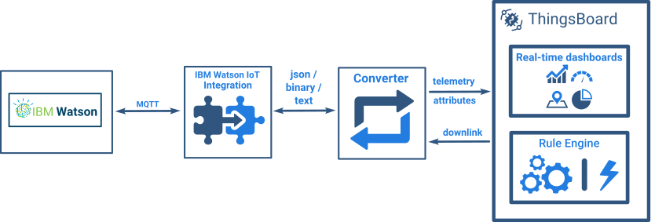

+++
title = "IBM Watson IoT Integration"
description = "IBM Watson IoT Integration Guide"

[extra]
status = "imported"
checked = ""
source = "docs/user-guide/integrations/ibm-watson-iot.md"
+++

SENTIENT Professional Edition feature

Only [**Professional Edition**](/products/sentient-pe/) supports **Platform Integrations** feature. 
Use [**SENTIENT Cloud**](/installations/choose-region/) or [**install**](/docs/user-guide/install/pe/installation-options/) your own platform instance.

## Overview

IBM Watson IoT Integration allows to stream data from IBM Watson IoT to SENTIENT and converts device payloads to the SENTIENT format.

 
 
## Video tutorial
 
See video tutorial below for step-by-step instruction how to setup IBM Watson IoT Integration.

 

  
 

     <iframe referrerpolicy="strict-origin-when-cross-origin" src="https://www.youtube.com/embed/eqSObPW2P1g" frameborder="0" allowfullscreen></iframe>
 

 

## Next steps
