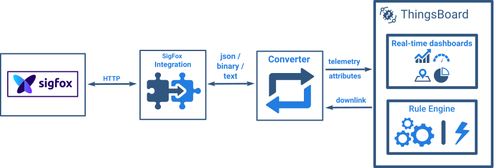

+++
title = "SigFox Integration"
description = "SigFox integration guide"

[extra]
status = "imported"
checked = ""
source = "docs/user-guide/integrations/sigfox.md"
+++
<div class="st-callout info"><p class="st-callout-title">SENTIENT Professional Edition feature</p>


Only **Professional Edition** supports **Platform Integrations** feature.<br>
Use **SENTIENT Cloud** or [**install**](/docs/installation/) your own platform instance.


</div>

## Overview

Sigfox Integration allows to stream data from Sigfox Backend to SENTIENT and converts binary device payloads to the SENTIENT format.

Please review the integration diagram to learn more.

 

## Prerequisites

In this tutorial, we will use:


 - The instance of [SENTIENT Professional Edition](https://sentient.invenia.in/docs/user-guide/install/pe/installation-options/) installed locally;
  
  

 - a [Sigfox](https://www.sigfox.com/) account;
 - a device registered with Sigfox.

Let’s assume that we have a device *Sigfox-2216792*. Our sensor device publishes "temperature", "humidity", "co2" and  "co2Baseline" readings.

## SigFox Integration Configuration

### Create Uplink Converter

You can сreate an uplink converter in the Data converters page or directly in the integration. Uplink converter is necessary in order to convert the incoming data from the device into the required format for displaying them in SENTIENT.

Go to the **Integration center** -> **Data converters** page and click "plus" button to create a new converter. Name it "**SigFox Uplink Converter**" and select type **Uplink**. To view the events, enable **debug mode**. In the function decoder field, specify a script to parse and transform data.

<b><font size="3">Debug mode</font></b>

Enabling debug mode allows you to track events, states, and potential errors related to the execution of integrations. This greatly simplifies development and troubleshooting.


<div class="st-callout info">


**Note:** Debug mode can quickly increase disk usage because all debug events are stored in the database.
Starting from **SENTIENT 3.9**, the platform stores the full set of debug events only during the first **15 minutes** after the integrations is created; afterward, only error events are retained.


</div>


Debug mode settings can be combined or disabled entirely.

Let’s review sample uplink message from SigFox device:
```json
{
  "device": "BF1327",
  "time": "1661868952",
  "data": "2502af2102462a",
  "seqNumber": "3737"
}
```
 - the "*device*" is responsible for the name of the device;
 - the "*data*" is a telemetry concatenation by two characters, where value "02af" - temperature, "21" - humidity*, "0246" - co2, "2a" - co2Baseline.
<br><br>

> One can use either [TBEL](/docs/user-guide/rhai/) (SENTIENT expression language) or JavaScript to develop user defined functions. 
We recommend utilizing [TBEL](/docs/user-guide/rhai/) as it's execution in SENTIENT is much more efficient compared to JS.


<div class="st-tabs">

<div class="st-tab" data-label="TBELRecommended">

You can use the following code, copy it to the decoder function section:

```javascript
/** Decoder **/

// decode payload to string
var json = decodeToJson(payload);
var deviceName = 'Sigfox-' + json.device;
var deviceType = 'Sigfox Airwits CO2';
var groupName = 'UC-0023 Sigfox Airwits CO2';

var attrByte = parseInt(json.data.substring(0, 2), 16); // force javascript to convert to INT
var autoCalibration = (attrByte & 0x1) === 1 ? "on" : "off"; // bitmask for first bit
var zeroPointAdjusted = ((attrByte & 0x2) >> 1) === 1 ? true : false; // bitmask for second bit; right shift one bit to get second bit to the LSB position
var transmitPower = ((attrByte & 0x4) >> 2) === 1 ? "full" : "low"; // bitmask for third bit; right shift two bits to get third bit to the LSB position
var powerControl = ((attrByte & 0x8) >> 3) === 1 ? "on" : "off"; // bitmask for third bit; right shift three bits to get fourth bit to the LSB position
var firmwareVersion = attrByte >> 4; // shift right to bring the nibble down to the first four bits; result is INT

var temperature = parseInt(json.data.substring(2, 6), 16) / 10.0 - 40;
var humidity = parseInt(json.data.substring(6, 8), 16);
var co2 = parseInt(json.data.substring(8, 12), 16);

var co2Baseline = 0;
var co2BaselineN = parseInt(json.data.substring(12, 14), 16);
if(co2BaselineN === 0){ // see documentation for more information on baseline
    co2Baseline = 400;
}else{
    co2Baseline = co2BaselineN * 10;
}

var result = {
// Use deviceName and deviceType or assetName and assetType, but not both.
    deviceName: deviceName,
    deviceType: deviceType,
    groupName: groupName,
    telemetry: {
        ts: json.time + "000",
        values:{
            //rssi: parseFloat(json.rssi),
            //snr: parseFloat(json.snr),
            temperature: toFixed(temperature, 1),
            humidity: humidity,
            co2: co2,
            co2Baseline: co2Baseline
        }
    },
    attributes:{
        //station: json.station,
        sigfox_id: json.device,
        autoCalibration: autoCalibration,
        zeroPointAdjusted: zeroPointAdjusted,
        transmitPower: transmitPower,
        powerControl: powerControl,
        fwVersion: firmwareVersion
    }
};

/** Helper functions 'decodeToString' and 'decodeToJson' are already built-in **/

return result;
```


</div>

<div class="st-tab" data-label="JavaScript">

You can use the following code, copy it to the decoder function section:

```javascript
/** Decoder **/

// decode payload to string
var json = decodeToJson(payload);
var deviceName = 'Sigfox-' + json.device;
var deviceType = 'Sigfox Airwits CO2';
var groupName = 'UC-0023 Sigfox Airwits CO2';

var attrByte = parseInt(json.data.substring(0, 2), 16); // force javascript to convert to INT
var autoCalibration = (attrByte & 0x1) === 1 ? "on" : "off"; // bitmask for first bit
var zeroPointAdjusted = ((attrByte & 0x2) >> 1) === 1 ? true : false; // bitmask for second bit; right shift one bit to get second bit to the LSB position
var transmitPower = ((attrByte & 0x4) >> 2) === 1 ? "full" : "low"; // bitmask for third bit; right shift two bits to get third bit to the LSB position
var powerControl = ((attrByte & 0x8) >> 3) === 1 ? "on" : "off"; // bitmask for third bit; right shift three bits to get fourth bit to the LSB position
var firmwareVersion = attrByte >> 4; // shift right to bring the nibble down to the first four bits; result is INT

var temperature = parseInt(json.data.substring(2, 6), 16) / 10 -40;
var humidity = parseInt(json.data.substring(6, 8), 16);
var co2 = parseInt(json.data.substring(8, 12), 16);

var co2Baseline = 0;
var co2BaselineN = parseInt(json.data.substring(12, 14), 16);
if(co2BaselineN === 0){ // see documentation for more information on baseline
    co2Baseline = 400;
}else{
    co2Baseline = co2BaselineN * 10;
}

var result = {
// Use deviceName and deviceType or assetName and assetType, but not both.
    deviceName: deviceName,
    deviceType: deviceType,
    groupName: groupName,
    telemetry: {
        ts: json.time + "000",
        values:{
            //rssi: parseFloat(json.rssi),
            //snr: parseFloat(json.snr),
            temperature: parseFloat(temperature.toFixed(1)),
            humidity: parseFloat(humidity),
            co2: co2,
            co2Baseline: co2Baseline
        }
    },
    attributes:{
        //station: json.station,
        sigfox_id: json.device,
        autoCalibration: autoCalibration,
        zeroPointAdjusted: zeroPointAdjusted,
        transmitPower: transmitPower,
        powerControl: powerControl,
        fwVersion: firmwareVersion
    }
};


/** Helper functions **/

function decodeToString(payload) {
    return String.fromCharCode.apply(String, payload);
}

function decodeToJson(payload) {
    // covert payload to string.
    var str = decodeToString(payload);

    // parse string to JSON
    var data = JSON.parse(str);
    return data;
}

return result;
```


</div>

</div>


### SigFox Integration Setup

 - Go to the **Integrations center** -> **Integrations** page and click "plus" icon to add a new integration. Name it "**SigFox Integration**", select type **SigFox**;


<div class="st-callout info">


**NOTE**
<br>
If the "Allow create devices or assets" checkbox is unchecked, when sending a message to sentient with any parameters of the device (or asset), if such a device (asset) does not exist, then device (asset) will not be created.


</div>


 - Add recently created **SigFox Uplink Converter**;
 - 
- For now, leave the "**Downlink data converter**" field empty;


 - Specify your **URL**;
 - Copy **HTTP endpoint URL** - we will use it later;
 - If necessary, you can specify additional parameters, without which the data will not be included in the integration. To do this, check the **Enable security** checkbox and click "Add" entity button. Specify an arbitrary *header* and *value*;
 - Click **Add** to create an integration.


## SigFox Configuration

Now we need to set up a **Sigfox account** so that data from our device is sent to the SENTIENT platform.

Go to your **Sigfox account** -> **Device type** -> enter your device type edit mode. In my case, this is "**thermostats**".


In "**Downlink data**" section specify **callback** downlink mode.


Then go to the **Callbacks** tab.

A **callback** is a custom http request containing your device data, along with other variables, sent to a given platform when the aforesaid device message is received by Sigfox cloud.

Create a callback to connect the Sigfox cloud to your SENTIENT platform. In the upper right corner, click on the "**New**" button, and select "**Custom callback**".


Specify **custom payload config**, **header filter**, and paste copied **HTTP endpoint URL** in URL pattern line.
Add a message body whose structure matches the message from your device. Click "**Ok**" to create callback.


Payload body:
```json
{
  "device": "{device}",
  "time": "{time}",
  "data":"{data}",
  "seqNumber": "{seqNumber}"
}
```


Make the downlink callback active. Click on the "**Downlink**" icon.


After this, the device is ready to send data to Sentient. Send an uplink message from the device. 

After you sent the uplink message a new device was created in Sentient. You should receive a **notification** about it. To view notification click on the "bell" icon in the upper right corner of the screen.
The notification will contain link to the *Sigfox-2216792* device provisioned by the integration (your device name may differ from the one shown in this example). Learn more about notifications and how to configure them [here](/docs/user-guide/notifications/). 

Navigate to this device.


Here you will see information about the new device. Navigate to the **Latest telemetry** tab to see the keys and their values.


Go to the "**Attributes**" tab. There you see the attributes of the device and its values.


Received data can also be viewed in the Uplink converter. In the "*In*" and "*Out*" blocks of the Events tab:


## Advanced usage: Downlink

Create another converter with the name "**SigFox Downlink Converter**" and select type **Downlink**. To see events - enable **Debug mode**.


<div class="st-tabs">

<div class="st-tab" data-label="TBELRecommended">

You can use our example of downlink converter, or write your own according to your configuration:

```javascript
// Encode downlink data from incoming Rule Engine message
// msg - JSON message payload downlink message json
// msgType - type of message, for ex. 'ATTRIBUTES_UPDATED', 'POST_TELEMETRY_REQUEST', etc.
// metadata - list of key-value pairs with additional data about the message
// integrationMetadata - list of key-value pairs with additional data defined in Integration executing this converter
// Result object with encoded downlink payload
var result = {
    // downlink data content type: JSON, TEXT or BINARY (base64 format)
    contentType: "TEXT",
    // downlink data
    data:  msg.test,
    // Optional metadata object presented in key/value format
    metadata: {
        "device": "2203961"
    }
};
return result;
```


</div>

<div class="st-tab" data-label="JavaScript">

You can use our example of downlink converter, or write your own according to your configuration:

```javascript
// Encode downlink data from incoming Rule Engine message
// msg - JSON message payload downlink message json
// msgType - type of message, for ex. 'ATTRIBUTES_UPDATED', 'POST_TELEMETRY_REQUEST', etc.
// metadata - list of key-value pairs with additional data about the message
// integrationMetadata - list of key-value pairs with additional data defined in Integration executing this converter
// Result object with encoded downlink payload
var result = {
    // downlink data content type: JSON, TEXT or BINARY (base64 format)
    contentType: "TEXT",
    // downlink data
    data:  msg.test,
    // Optional metadata object presented in key/value format
    metadata: {
        "device": "2203961"
    }
};
return result;
```


</div>

</div>


Now you have to add downlink converter to the integration.


When integration is configured, we need to go to the **Rule chains** page, choose **Root Rule Chain** and here create **integration downlink** node. Enter some name here, select the **SigFox Integration** you created earlier, and click Add.


After these steps, we need to tap on a right grey circle of the **message type switch** node and drag this circle to left side of the **integration downlink** node. Here choose '**Attribute Update**' and '**Post attributes**', tap "Add" and save Root Rule Chain.


### Test Downlink

To test downlink, create a **shared attribute** on your device and send some Uplink message on this device.


Go to your **Sigfox** account -> choose your device -> **Messages** tab. And you will see Downlink message


Go to the **Statistics** tab. You will see a downlink message on the chart.


## Video tutorial
 
See video tutorial below for step-by-step instruction how to setup SigFox Integration.

<br>
<div id="video"> 
 <div id="video_wrapper">
     <iframe referrerpolicy="strict-origin-when-cross-origin" src="https://www.youtube.com/embed/T769XqaqeFU" frameborder="0" allowfullscreen></iframe>
 </div>
</div>

## Next steps
