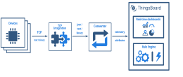

+++
title = "TCP Integration"
description = "TCP Integration Guide"

[extra]
status = "imported"
checked = ""
source = "docs/user-guide/integrations/tcp.md"
+++
<div class="st-callout info"><p class="st-callout-title">SENTIENT Professional Edition feature</p>


Only **Professional Edition** supports **Platform Integrations** feature.<br>
Use **SENTIENT Cloud** or [**install**](/docs/installation/) your own platform instance.


</div>

TCP Integration allows to stream data from devices which use a TCP transport protocol to SENTIENT and converts payloads of these devices into the SENTIENT format.


<div class="st-callout info">


**Please note** TCP Integration can be started only as [remote Integration](/docs/user-guide/integrations/remote-integrations). It could be started on the same machine, where TB instance is running, or you can start in on another machine, that has access over the network to the TB instance.


</div>


Please review the integration diagram to learn more.



## Prerequisites

In this tutorial, we will use:


 - The instance of [SENTIENT Professional Edition](https://sentient.invenia.in/docs/user-guide/install/pe/installation-options/) installed locally;
 - TCP Integration, running externally and connected to the cloud SENTIENT Professional Edition instance;
 - **echo** command which intended to display a line of text, and will redirect it's output to **netcat** (**nc**) utility;
 - **netcat** (**nc**) utility to establish TCP connections, receive data from there and transfer them;    

Let's assume that we have a sensor which is sending current temperature and humidity readings.
Our sensor device **SN-002** publishes it's temperature and humidity readings to TCP Integration on **10560** port to the machine where TCP Integration is running.

For demo purposes we assume that our device is smart enough to send data in 3 different payload types:

You can select payload type based on your device capabilities and business cases:


<div class="st-tabs">

<div class="st-tab" data-label="Text payload">

In this case, the payload looks like this:

```
SN-002,default,temperature,25.7\n\rSN-002,default,humidity,69
```

</div>

<div class="st-tab" data-label="JSON payload">

In this case, the payload looks like this:

```json
[
  {
    "deviceName": "SN-002",
    "deviceType": "default",
    "temperature": 25.7,
    "humidity": 69
  }
]
```

</div>

<div class="st-tab" data-label="Binary payload">

In this case, the payload looks like this:

```
\x30\x30\x30\x30\x11\x53\x4e\x2d\x30\x30\x32\x64\x65\x66\x61\x75\x6c\x74\x32\x35\x2e\x37\x00\x00\x00
```

Here is the description of the bytes in this payload:
- **0-3** bytes - **\x30\x30\x30\x30** - dummy bytes to show how you can skip particular prefix bytes in your payload. These bytes are included for sample purposes;
- **4** byte - **\x11** - payload length. If we convert it to decimal - **17**. So our payload in this case is limited to 17 bytes from the incoming TCP frame;
- **5-10** bytes - **\x53\x4e\x2d\x30\x30\x32** - device name. If we convert it to text - **SN-002**;
- **11-17** bytes - **\x64\x65\x66\x61\x75\x6c\x74** - device type. If we convert it to text - **default**;
- **18-21** bytes - **\x32\x35\x2e\x37** - temperature telemetry. If we convert it to text - **25.7**;
- **22-24** bytes - **\x00\x00\x00** - dummy bytes. We are going to ignore them, because payload size is **17** bytes - from **5** till **21** byte. These bytes are included for sample purposes;


</div>

</div>

 


<div class="st-callout info">


**Please note**
<br>
On the machine, where TCP Integration is running, port **10560** must be opened for incoming connections - **nc** utility must be able to connect to TCP socket. In case you are running it locally, it should be fine without any additional changes.


</div>


## Add TCP integration

**1. Basic settings**.

Go to the "**Integrations**" page of the "**Integrations center**" section. Click "plus" button to start adding new integration. Select type "**TCP**" integration and click "**Next**";


<br>
**2. Uplink data converter**. 

An uplink converter that is a script for parsing and transforming the data received by TCP integration to a format that SENTIENT can consume.
**deviceName** and **deviceType** are required, while **attributes** and **telemetry** are optional. **attributes** and **telemetry** are flat key-value objects. Nested objects are not supported.

Choose device payload type to for decoder configuration:


<div class="st-tabs">

<div class="st-tab" data-label="Text payload">

> One can use either [TBEL](/docs/user-guide/rhai/) (SENTIENT expression language) or JavaScript to develop user defined functions. 
We recommend utilizing [TBEL](/docs/user-guide/rhai/) as it's execution in SENTIENT is much more efficient compared to JS.

Now copy the following **TBEL** script:

```javascript
/** Decoder **/

// decode payload to string
var strArray = decodeToString(payload);
var payloadArray = strArray.replaceAll("\"", "").replaceAll("\\\\n", "").split(',');

var telemetryPayload = {};
for (var i = 2; i < payloadArray.length; i = i + 2) {
    var telemetryKey = payloadArray[i];
    var telemetryValue = parseFloat(payloadArray[i + 1]);
    telemetryPayload[telemetryKey] = telemetryValue;
}

// Result object with device attributes/telemetry data
var result = {
    deviceName: payloadArray[0],
    deviceType: payloadArray[1],
    telemetry: telemetryPayload,
    attributes: {}
};

/** Helper functions 'decodeToString' and 'decodeToJson' are already built-in **/

return result;
```


<br>
If you want to use the **JavaScript decoder function**, use this script:

```javascript
/** Decoder **/

// decode payload to string
var strArray = decodeToString(payload);
var payloadArray = strArray.replace(/\"/g, "").replace(/\s/g, "").split(',');

var telemetryKey = payloadArray[2];
var telemetryValue = payloadArray[3];

var telemetryPayload = {};
telemetryPayload[telemetryKey] = telemetryValue;

// Result object with device attributes/telemetry data
var result = {
    deviceName: payloadArray[0],
    deviceType: payloadArray[1],
    telemetry: telemetryPayload,
    attributes: {}
};

/** Helper functions **/

function decodeToString(payload) {
    return String.fromCharCode.apply(String, payload);
}

return result;
``` 


<br>
Paste the copied script to the decoder function section. Then, click "**Next**";


</div>

<div class="st-tab" data-label="JSON payload">

> One can use either [TBEL](/docs/user-guide/rhai/) (SENTIENT expression language) or JavaScript to develop user defined functions. 
We recommend utilizing [TBEL](/docs/user-guide/rhai/) as it's execution in SENTIENT is much more efficient compared to JS.

Now copy the following **TBEL** script:

```javascript
/** Decoder **/

// decode payload to JSON
var data = decodeToJson(payload);

// Result object with device/asset attributes/telemetry data

var deviceName = data.deviceName;
var deviceType = data.deviceType;
var result = {
    deviceName: deviceName,
    deviceType: deviceType,
    attributes: {},
    telemetry: {
        temperature: data.temperature,
        humidity: data.humidity
    }
};

/** Helper functions 'decodeToString' and 'decodeToJson' are already built-in **/

return result;
```


<br>
If you want to use the **JavaScript decoder function**, use this script:

```javascript
/** Decoder **/

// decode payload to JSON
var data = decodeToJson(payload);

// Result object with device/asset attributes/telemetry data

var deviceName = data.deviceName;
var deviceType = data.deviceType;
var result = {
    deviceName: deviceName,
    deviceType: deviceType,
    attributes: {},
    telemetry: {
        temperature: data.temperature,
        humidity: data.humidity
    }
};

/** Helper functions **/

function decodeToString(payload) {
    return String.fromCharCode.apply(String, payload);
}

function decodeToJson(payload) {
    // covert payload to string.
    var str = decodeToString(payload);

    // parse string to JSON
    var data = JSON.parse(str);
    return data;
}

return result;
```


<br>
Paste the copied script to the decoder function section. Then, click "**Next**";


</div>

<div class="st-tab" data-label="Binary payload">

> One can use either [TBEL](/docs/user-guide/rhai/) (SENTIENT expression language) or JavaScript to develop user defined functions. 
We recommend utilizing [TBEL](/docs/user-guide/rhai/) as it's execution in SENTIENT is much more efficient compared to JS.

Now copy the following **TBEL** script:

```javascript
/** Decoder **/

// decode payload to string
var payloadStr = decodeToString(payload);

// decode payload to JSON
// var data = decodeToJson(payload);

var deviceName = payloadStr.substring(0,6);
var deviceType = payloadStr.substring(6,13);

// Result object with device/asset attributes/telemetry data
var result = {
    deviceName: deviceName,
    deviceType: deviceType,
    attributes: {},
    telemetry: {
        temperature: parseFloat(payloadStr.substring(13,17))
    }
};

/** Helper functions 'decodeToString' and 'decodeToJson' are already built-in **/

return result;
```


<br>
If you want to use the **JavaScript decoder function**, use this script:

```javascript
/** Decoder **/

// decode payload to string
var payloadStr = decodeToString(payload);

// decode payload to JSON
// var data = decodeToJson(payload);

var deviceName = payloadStr.substring(0,6);
var deviceType = payloadStr.substring(6,13);

// Result object with device/asset attributes/telemetry data
var result = {
   deviceName: deviceName,
   deviceType: deviceType,
   attributes: {},
   telemetry: {
       temperature: parseFloat(payloadStr.substring(13,17))
   }
};

/** Helper functions **/

function decodeToString(payload) {
   return String.fromCharCode.apply(String, payload);
}

function decodeToJson(payload) {
   // covert payload to string.
   var str = decodeToString(payload);

   // parse string to JSON
   var data = JSON.parse(str);
   return data;
}

return result;
```


<br>
Paste the copied script to the decoder function section. Then, click "**Next**";


</div>

</div>


<div class="st-callout info">


**NOTE**
<br>
Although the Debug mode is very useful for development and troubleshooting, leaving it enabled in production mode may tremendously increase the disk space, used by the database, because all the debugging data is stored there. It is highly recommended to turn the Debug mode off when done debugging.


</div>


**3. Downlink data converter**.

At the step of adding a downlink converter, you can also select a previously created or create a new downlink converter. But for now, leave the "**Downlink data converter**" field empty. Click "**Skip**";


<br>
**4. Connection**.

As you mentioned earlier, "**Execute remotely**" option is checked and can not be modified - TCP Integration can be only **remote** type.

By default, TCP Integration will use **10560** port, but you can change this to any available port in your case.

Please note down **Integration key** and **Integration secret** - we will use these values later in the configuration on the remote TCP Integration itself.

Choose device payload type for **Handler Configuration**


<div class="st-tabs">

<div class="st-tab" data-label="Text payload">


To parse payload properly, please make sure that next values are set:
- **Max Frame Length** - the maximum length of the decoded frame. An exception will be thrown if the length of the frame exceeds this value; Leave it by default for this demo - **128**; 
- **Strip Delimiter** - whether the decoded frame should strip out the delimiter or not. Please check it to drop newline delimiter from the payload;
- **Message Separator** - specify it to **System Line Separator** - in this case newline symbol will be used as delimiter;


</div>

<div class="st-tab" data-label="JSON payload">


<br>


</div>

<div class="st-tab" data-label="Binary payload">


To parse payload properly, please make sure that next values are set:
- **Max Frame Length** - the maximum length of the decoded frame. An exception will be thrown if the length of the frame exceeds this value; Leave it by default for this demo - **128**; 
- **Length Field Offset** - the offset of the length field. In our case length field is 5th byte in the payload \x30\x30\x30\x30 **\x11** \x53.... So set it to **4**;
- **Length Field Length** - the length of the length field. In our case length of the length field is 1 byte ...\x30 **\x11** \x53.... So set it to **1**;
- **Length Adjustment (the compensation value to add to the value of the length field)** - the compensation value to add to the value of the length field. In our case we don't need this compensation, as length field contains correct value - **17** bytes. So leave it **0**;
- **Number of first bytes to strip out from the decoded frame** - the number of first bytes to strip out from the decoded frame. We need to skip first 5 bytes from the decoded payload, to get our data - \x30\x30\x30\x30\x11 **\x53\x4e\x2d\x30...**. So set it to **5**;


</div>

</div>


We leave other options by default, but there is brief description of them:
- **Max number of pending connects on the socket** - The maximum queue length for incoming connection indications (a request to connect) is set to the backlog parameter. If a connection indication arrives when the queue is full, the connection is refused;
- **Size of the buffer for inbound socket** - the size in KBytes of the socket data receive buffer;
- **Size of the buffer for outbound socket** - the size in KBytes of the socket data send buffer;
- **Enable sending of keep-alive messages on connection-oriented sockets** - a flag indicating that probes should be periodically sent across the network to the opposing socket to keep the connection alive;
- **Forces a socket to send the data without buffering (disable Nagle's buffering algorithm)** - disables Nagle's algorithm on the socket which delays the transmission of data until a certain volume of pending data has accumulated.

Click "**Add**" to finish adding the TCP integration.

## Installing and running external TCP Integration

Please refer to the [remote integration guide](/docs/user-guide/integrations/remote-integrations) and install TCP integration service locally or on separate machine.

Please use **Integration key** and **Integration secret** from the above section for your TCP Integration configuration.

## Send uplink message

Once SENTIENT TCP Integration has been created, the TCP server starts, and then it waits for data from the devices.

Choose device payload type to send uplink message


<div class="st-tabs">

<div class="st-tab" data-label="Text payload">

The command to send a message to the TCP server that is running on localhost (127.0.0.1) will look like this:

```bash
echo -e 'SN-002,default,temperature,25.7' | nc -q0 127.0.0.1 10560
```


We can also send multiple messages in one string, separated by **Message Separator** (**System Line Delimiter**).
Newline delimiter (**\n**) will be used to split payload into multiple messages.

In this case, the command will look like this:

```bash
echo -e 'SN-002,default,temperature,25.7\nSN-002,default,humidity,69' | nc -q1 -w1 127.0.0.1 10560
```


If you want to send a message back to the device using **Downlink,** the command will look like this:

```bash
echo -e 'SN-002,default,temperature,25.7' | nc 127.0.0.1 10560
```


For multiple messages in one string:

```bash
echo -e 'SN-002,default,temperature,25.7\nSN-002,default,humidity,69' | nc -w60 127.0.0.1 10560
```


</div>

<div class="st-tab" data-label="JSON payload">

The command to send a message to the TCP server that is running on localhost (127.0.0.1) will look like this:

```bash
echo -e -n '{"deviceName": "SN-002", "deviceType": "default", "temperature": 25.7, "humidity": 69}' | nc -q1 -w1 127.0.0.1 10560
```


If you want to send a message back to the device using **Downlink,** the command will look like this:

```bash
echo -e -n '{"deviceName": "SN-002", "deviceType": "default", "temperature": 25.7, "humidity": 69}' | nc -w60 127.0.0.1 10560
```


</div>

<div class="st-tab" data-label="Binary payload">

The command to send a message to the TCP server that is running on localhost (127.0.0.1) will look like this:

```bash
echo -e -n '\x30\x30\x30\x30\x11\x53\x4e\x2d\x30\x30\x32\x64\x65\x66\x61\x75\x6c\x74\x32\x35\x2e\x37\x00\x00\x00' | nc -q1 -w1 127.0.0.1 10560
```


If you want to send a message back to the device using **Downlink,** the command will look like this:

```bash
echo -e -n '\x30\x30\x30\x30\x11\x53\x4e\x2d\x30\x30\x32\x64\x65\x66\x61\x75\x6c\x74\x32\x35\x2e\x37\x00\x00\x00' | nc -w60 127.0.0.1 10560
```


</div>

</div>


Going to the "**Devices**" page you should find a **SN-002** device provisioned by the TCP integration.
Click on the device, navigate to the "**Latest telemetry**" tab to see "**temperature**" key and its value (25.7) there.


If your payload contains "**humidity**" telemetry, you should see "humidity" key and its value (69) there as well.

## Advanced usage: downlink

For sending downlink messages from the Sentient to the device, we need to define a downlink converter.

### Add downlink converter

Let's consider an example where we send an attribute update message. You can use our example of downlink converter, or write your own according to your configuration.

> One can use either [TBEL](/docs/user-guide/rhai/) (SENTIENT expression language) or JavaScript to develop user defined functions. 
We recommend utilizing [TBEL](/docs/user-guide/rhai/) as it's execution in SENTIENT is much more efficient compared to JS.


<div class="st-tabs">

<div class="st-tab" data-label="TBELRecommended">

Copy the following script:

```javascript
// Encode downlink data from incoming Rule Engine message

// msg - JSON message payload downlink message json
// msgType - type of message, for ex. 'ATTRIBUTES_UPDATED', 'POST_TELEMETRY_REQUEST', etc.
// metadata - list of key-value pairs with additional data about the message
// integrationMetadata - list of key-value pairs with additional data defined in Integration executing this converter

/** Encoder **/

var data = {};

// Process data from incoming message and metadata

data.tempFreq = msg.temperatureUploadFrequency;
data.humFreq = msg.humidityUploadFrequency;

data.devSerialNumber = metadata['ss_serialNumber'];

// Result object with encoded downlink payload
var result = {

    // downlink data content type: JSON, TEXT or BINARY (base64 format)
    contentType: "JSON",

    // downlink data
    data: JSON.stringify(msg),

    // Optional metadata object presented in key/value format
    metadata: {
            topic: metadata['deviceType']+'/'+metadata['deviceName']+'/upload'
    }

};

return result;
```


</div>

<div class="st-tab" data-label="JavaScript">

Copy the following script:

```javascript
// Encode downlink data from incoming Rule Engine message

// msg - JSON message payload downlink message json
// msgType - type of message, for ex. 'ATTRIBUTES_UPDATED', 'POST_TELEMETRY_REQUEST', etc.
// metadata - list of key-value pairs with additional data about the message
// integrationMetadata - list of key-value pairs with additional data defined in Integration executing this converter

/** Encoder **/

var data = {};

// Process data from incoming message and metadata

data.tempFreq = msg.temperatureUploadFrequency;
data.humFreq = msg.humidityUploadFrequency;

data.devSerialNumber = metadata['ss_serialNumber'];

// Result object with encoded downlink payload
var result = {

    // downlink data content type: JSON, TEXT or BINARY (base64 format)
    contentType: "JSON",

    // downlink data
    data: JSON.stringify(msg),

    // Optional metadata object presented in key/value format
    metadata: {
            topic: metadata['deviceType']+'/'+metadata['deviceName']+'/upload'
    }

};

return result;
```


</div>

</div>


To add a downlink data converter to the TCP integration, follow these steps:


1. Go to the "**Integrations**" page, click TCP integration to open its details, and enter integration editing mode by clicking the "pencil" icon;

1. Enter a name for the downlink data converter and click "**Create new converter**";

1. Paste the script to the encoder function section, and click "Add";

1. Apply changes.


<div class="st-gallery"><figure><figcaption>Go to the "**Integrations**" page, click TCP integration to open its details, and enter integration editing mode by clicking the "pencil" icon;</figcaption></figure><figure><figcaption>Enter a name for the downlink data converter and click "**Create new converter**";</figcaption></figure><figure><figcaption>Paste the script to the encoder function section, and click "Add";</figcaption></figure><figure><figcaption>Apply changes.</figcaption></figure></div>


<div class="st-callout info">


Optionally, configure **Cache Size** and **Cache time to live in minutes** - features, that helps to avoid memory leak when we are storing connections (able just for TCP downlink).<br>
**Cache Size** - maximum size of messages for TCP client.<br>
**Cache time to live in minutes** - time to storage messages.


</div>


### Modify Root Rule Chain

When integration configured and ready to use, we need to go to the "Rule Chains" page and configure the "**Root Rule Chain**" so that "**Attributes updated**" messages is forwarded to the downlink data converter.


1. Open the "Root Rule Chain", find the "**integration downlink**" node and drag it to the rule chain. Name it "**TCP integration downlink**", specify **TCP integration**, and click "Add";

1. After this steps, we need to tap on a right grey circle of rule node "**message type switch**" and drag this circle to left side of "**integration downlink**", here lets choose **Attributes Updated**, tap "**Add**" and save Root Rule Chain.


<div class="st-gallery"><figure><figcaption>Open the "Root Rule Chain", find the "**integration downlink**" node and drag it to the rule chain. Name it "**TCP integration downlink**", specify **TCP integration**, and click "Add";</figcaption></figure><figure><figcaption>After this steps, we need to tap on a right grey circle of rule node "**message type switch**" and drag this circle to left side of "**integration downlink**", here lets choose **Attributes Updated**, tap "**Add**" and save Root Rule Chain.</figcaption></figure></div>


### Test downlink

To test downlink, create some **shared attribute** on your device:


1. Go to the "**Devices**" page. Click your **SN-002** device and navigate to the "**Attributes**" tab. Select the "**Shared attributes**" option, and click the "**plus**" icon;

1. Enter the attribute name, and its value (for example, the key name is "**firmware**", value: "**v1.1**") and click "Save";


<div class="st-gallery"><figure><figcaption>Go to the "**Devices**" page. Click your **SN-002** device and navigate to the "**Attributes**" tab. Select the "**Shared attributes**" option, and click the "**plus**" icon;</figcaption></figure><figure><figcaption>Enter the attribute name, and its value (for example, the key name is "**firmware**", value: "**v1.1**") and click "Save";</figcaption></figure><figure><figcaption></figcaption></figure></div>


To receive a downlink message you need to set the timeout for responses `-w60` (this option determines how long you will wait for a response) and send the uplink message again:

```bash
echo -e 'SN-002,default,temperature,25.7\nSN-002,default,humidity,69' | nc -w60 127.0.0.1 11560
```


You should get the following response from the SENTIENT in the terminal:


Received data and data that was sent can be viewed in the downlink converter. In the "**In**" block of the "**Events**" tab, we see what data entered. The "**Out**" field displays messages to device.


<div class="st-gallery"><figure><figcaption>Received data and data that was sent can be viewed in the downlink converter. In the "**In**" block of the "**Events**" tab, we see what data entered.</figcaption></figure><figure><figcaption>The "**Out**" field displays messages to device.</figcaption></figure></div>


<div class="st-callout info">


**Note**
<br>
When you use TCP integration, and your connection established for a long time, you will receive just one downlink message. All other will be saved on server side and will be sent on next uplink.


</div>


## Next steps
