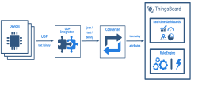

+++
title = "UDP Integration"
description = "UDP Integration Guide"

[extra]
status = "imported"
checked = ""
source = "docs/user-guide/integrations/udp.md"
+++
<div class="st-callout info"><p class="st-callout-title">SENTIENT Professional Edition feature</p>


Only [**Professional Edition**](/products/sentient-pe/) supports **Platform Integrations** feature.<br>
Use [**SENTIENT Cloud**](/installations/choose-region/) or [**install**](/docs/user-guide/install/pe/installation-options/) your own platform instance.


</div>

UDP Integration allows to stream data from devices which use a UDP protocol to SENTIENT and converts payloads of these devices into the SENTIENT format.


<div class="st-callout info">


**Please note** UDP Integration can be started only as [remote integration](/docs/user-guide/integrations/remote-integrations). It could be started on the same machine, where TB instance is running, or you can start in on another machine, that has access over the network to the TB instance.


</div>


Please review the integration diagram to learn more.



## Prerequisites

In this tutorial, we will use:


- The instance of the [SENTIENT Professional Edition](https://sentient.invenia.in/docs/user-guide/install/pe/installation-options/) installed locally;
- UDP integration, running externally and connected to the SENTIENT Professional Edition instance;
- **echo** command which intended to display a line of text, and will redirect it's output to **netcat** (**nc**) utility;
- **netcat** (**nc**) utility to establish UDP connections, receive data from there and transfer them;

Suppose we have a sensor sending current temperature and humidity readings. 
Sensor **SN-001** sends data to UDP integration on port **11560** of the machine where the UDP integration is running.

For demo purposes we assume that our device is smart enough to send data in 4 different payload types. 
You can select payload type based on your device capabilities and business cases:
 


<div class="st-tabs">

<div class="st-tab" data-label="Text payload">

In this case, the payload looks like this:

```
SN-001,default,temperature,25.7,humidity,69
```

</div>

<div class="st-tab" data-label="JSON payload">

In this case, the payload looks like this:

```json
{
  "deviceName": "SN-001",
  "deviceType": "default",
  "temperature": 25.7,
  "humidity": 69
}
```

</div>

<div class="st-tab" data-label="Binary payload">

In this case, the payload looks like this:

```
\x53\x4e\x2d\x30\x30\x31\x64\x65\x66\x61\x75\x6c\x74\x32\x35\x2e\x37\x36\x39
``` 

Here is the description of the bytes in this payload:
- **0-5** bytes - **\x53\x4e\x2d\x30\x30\x31** - device name. If we convert it to text - **SN-001**;
- **6-12** bytes - **\x64\x65\x66\x61\x75\x6c\x74** - device type. If we convert it to text - **default**;
- **13-16** bytes - **\x32\x35\x2e\x37** - temperature telemetry. If we convert it to text - **25.7**;
- **17-18** bytes - **\x36\x39** - humidity telemetry. If we convert it to text - **69**.

</div>

<div class="st-tab" data-label="Hex payload">

In this case payload is hexadecimal string:

```
534e2d30303164656661756c7432352e373639
``` 

Here is the description of the bytes in this payload:
- **0-5** bytes - **534e2d303031** - device name. If we convert it to text - **SN-001**;
- **6-12** byte - **64656661756c74** - device type. If we convert it to text - **default**;
- **13-16** byte - **32352e37** - temperature telemetry. If we convert it to text: - **25.7**;
- **17-18** byte - **3639** - humidity telemetry. If we convert it to text: - **69**.

</div>

</div>


<div class="st-callout info">


**Please note**
<br>
On the machine, where UDP Integration is running, port **11560** must be opened for incoming connections - **nc** utility must be able to connect to UDP socket. In case you are running it locally, it should be fine without any additional changes.


</div>


## Add UDP integration

**1. Basic settings**.

Go to the "**Integrations**" page of the "**Integrations center**" section. Click "plus" button to start adding new integration. Select type "**UDP**" integration and click "**Next**";


<br>
**2. Uplink data converter**. 

An uplink converter that is a script for parsing and transforming the data received by UDP integration to format that SENTIENT uses. 
**deviceName** and **deviceType** are required, while attributes and telemetry are optional. attributes and telemetry are flat key-value objects. Nested objects are not supported.

**Choose device payload type to for decoder configuration:**


<div class="st-tabs">

<div class="st-tab" data-label="Text payload">

> One can use either [TBEL](/docs/pe/user-guide/tbel/) (SENTIENT expression language) or JavaScript to develop user defined functions. 
We recommend utilizing [TBEL](/docs/pe/user-guide/tbel/) as it's execution in SENTIENT is much more efficient compared to JS.

Now copy the following **TBEL** script:

```javascript
/** Decoder **/

// decode payload to string
var strArray = decodeToString(payload);
var payloadArray = strArray.replaceAll("\"", "").replaceAll("\\\\n", "").split(',');

var telemetryPayload = {};
for (var i = 2; i < payloadArray.length; i = i + 2) {
    var telemetryKey = payloadArray[i];
    var telemetryValue = parseFloat(payloadArray[i + 1]);
    telemetryPayload[telemetryKey] = telemetryValue;
}

// Result object with device attributes/telemetry data
var result = {
    deviceName: payloadArray[0],
    deviceType: payloadArray[1],
    telemetry: telemetryPayload,
    attributes: {}
};

/** Helper functions 'decodeToString' and 'decodeToJson' are already built-in **/

return result;
``` 


<br>
If you want to use the **JavaScript decoder function**, use this script:

```javascript
/** Decoder **/

// decode payload to string
var strArray = decodeToString(payload);
var payloadArray = strArray.replace(/\"/g, "").replace(/\s/g, "").replace(/\\n/g, "").split(',');

var telemetryPayload = {};
for (var i = 2; i < payloadArray.length; i = i + 2) {
    var telemetryKey = payloadArray[i];
    var telemetryValue = parseFloat(payloadArray[i + 1]);
    telemetryPayload[telemetryKey] = telemetryValue;
}

// Result object with device attributes/telemetry data
var result = {
    deviceName: payloadArray[0],
    deviceType: payloadArray[1],
    telemetry: telemetryPayload,
    attributes: {}
  };

/** Helper functions **/

function decodeToString(payload) {
   return String.fromCharCode.apply(String, payload);
}

return result;
``` 


<br>
Paste the copied script to the decoder function section. Then, click "**Next**";


<div class="st-callout info">


**NOTE**
<br>
Although the Debug mode is very useful for development and troubleshooting, leaving it enabled in production mode may tremendously increase the disk space, used by the database, because all the debugging data is stored there. It is highly recommended to turn the Debug mode off when done debugging.


</div>


</div>

<div class="st-tab" data-label="JSON payload">

> One can use either [TBEL](/docs/pe/user-guide/tbel/) (SENTIENT expression language) or JavaScript to develop user defined functions. 
We recommend utilizing [TBEL](/docs/pe/user-guide/tbel/) as it's execution in SENTIENT is much more efficient compared to JS.

Now copy the following **TBEL** script:

```javascript
/** Decoder **/

// decode payload to JSON
var data = decodeToJson(payload);

// Result object with device/asset attributes/telemetry data

var deviceName = data.deviceName;
var deviceType = data.deviceType;
var result = {
    deviceName: deviceName,
    deviceType: deviceType,
    attributes: {},
    telemetry: {
        temperature: data.temperature,
        humidity: data.humidity
    }
};

/** Helper functions 'decodeToString' and 'decodeToJson' are already built-in **/

return result;
``` 


<br>
If you want to use the **JavaScript decoder function**, use this script:

```javascript
/** Decoder **/

// decode payload to JSON
var data = decodeToJson(payload);

// Result object with device/asset attributes/telemetry data

var deviceName = data.deviceName;
var deviceType = data.deviceType;
var result = {
    deviceName: deviceName,
    deviceType: deviceType,
    attributes: {},
    telemetry: {
        temperature: data.temperature,
        humidity: data.humidity
   }
};

/** Helper functions **/

function decodeToString(payload) {
   return String.fromCharCode.apply(String, payload);
}

function decodeToJson(payload) {
   // covert payload to string.
   var str = decodeToString(payload);

   // parse string to JSON
   var data = JSON.parse(str);
   return data;
}

return result;

``` 


<br>
Paste the copied script to the decoder function section. Then, click "**Next**";


<div class="st-callout info">


**NOTE**
<br>
Although the Debug mode is very useful for development and troubleshooting, leaving it enabled in production mode may tremendously increase the disk space, used by the database, because all the debugging data is stored there. It is highly recommended to turn the Debug mode off when done debugging.


</div>


</div>

<div class="st-tab" data-label="Binary payload">

> One can use either [TBEL](/docs/pe/user-guide/tbel/) (SENTIENT expression language) or JavaScript to develop user defined functions. 
We recommend utilizing [TBEL](/docs/pe/user-guide/tbel/) as it's execution in SENTIENT is much more efficient compared to JS.

Now copy the following **TBEL** script:

```javascript
/** Decoder **/

// decode payload to string
var payloadStr = decodeToString(payload);

// decode payload to JSON
// var data = decodeToJson(payload);

var deviceName = payloadStr.substring(0,6);
var deviceType = payloadStr.substring(6,13);

// Result object with device/asset attributes/telemetry data
var result = {
   deviceName: deviceName,
   deviceType: deviceType,
   attributes: {},
   telemetry: {
       temperature: parseFloat(payloadStr.substring(13,17)),
       humidity: parseFloat(payloadStr.substring(17,19))
   }
};

/** Helper functions 'decodeToString' and 'decodeToJson' are already built-in **/

return result;
``` 


<br>
If you want to use the **JavaScript decoder function**, use this script:

```javascript
/** Decoder **/

// decode payload to string
var payloadStr = decodeToString(payload);

// decode payload to JSON
// var data = decodeToJson(payload);

var deviceName = payloadStr.substring(0,6);
var deviceType = payloadStr.substring(6,13);

// Result object with device/asset attributes/telemetry data
var result = {
   deviceName: deviceName,
   deviceType: deviceType,
   attributes: {},
   telemetry: {
       temperature: parseFloat(payloadStr.substring(13,17)),
       humidity: parseFloat(payloadStr.substring(17,19))
   }
};

/** Helper functions **/

function decodeToString(payload) {
   return String.fromCharCode.apply(String, payload);
}

function decodeToJson(payload) {
   // covert payload to string.
   var str = decodeToString(payload);

   // parse string to JSON
   var data = JSON.parse(str);
   return data;
}

return result;
``` 


<br>
Paste the copied script to the decoder function section. Then, click "**Next**";


<div class="st-callout info">


**NOTE**
<br>
Although the Debug mode is very useful for development and troubleshooting, leaving it enabled in production mode may tremendously increase the disk space, used by the database, because all the debugging data is stored there. It is highly recommended to turn the Debug mode off when done debugging.


</div>


</div>

<div class="st-tab" data-label="Hex payload">

> One can use either [TBEL](/docs/pe/user-guide/tbel/) (SENTIENT expression language) or JavaScript to develop user defined functions. 
We recommend utilizing [TBEL](/docs/pe/user-guide/tbel/) as it's execution in SENTIENT is much more efficient compared to JS.

Now copy the following **TBEL** script:

```javascript
/** Decoder **/

// decode payload to JSON
var data = decodeToJson(payload).reports[0].value;

// Result object with device telemetry data
var result = {
    deviceName: hexToString(data.substring(0, 12)),
    deviceType: hexToString(data.substring(12, 26)),
    telemetry: {
        temperature: parseFloat(hexToString(data.substring(26, 34))),
        humidity: parseFloat(hexToString(data.substring(34, 38))),
    }
};

/** Helper functions **/

// Hexadecimal string to string
function hexToString(hex) {
    return bytesToString(hexToBytes(hex));
}

return result;
``` 


<br>
If you want to use the **JavaScript decoder function**, use this script:

```javascript
/** Decoder **/

// decode payload to JSON
var data = decodeToJson(payload).reports[0].value;

// Result object with device telemetry data
var result = {
    deviceName: hexToString(data.substring(0, 12)),
    deviceType: hexToString(data.substring(12, 26)),
    telemetry: {
        temperature: parseFloat(hexToString(data.substring(26, 34))),
        humidity: parseFloat(hexToString(data.substring(34, 38))),
    }
};

/** Helper functions **/

function decodeToString(payload) {
    return String.fromCharCode.apply(String, payload);
}

// Hexadecimal string to string
function hexToString(hex) {
    var str = '';
    for (var i = 0; i < hex.length; i += 2) {
        var notNullValue = parseInt(hex.substr(i, 2), 16);
        if (notNullValue) {
            str += String.fromCharCode(notNullValue);
        }
    }
    return str;
}

function decodeToJson(payload) {
    // convert payload to string.
    var str = decodeToString(payload);

    // parse string to JSON
    var data = JSON.parse(str);
    return data;
}

return result;
``` 


<br>
Paste the copied script to the decoder function section. Then, click "**Next**";


<div class="st-callout info">


**NOTE**
<br>
Although the Debug mode is very useful for development and troubleshooting, leaving it enabled in production mode may tremendously increase the disk space, used by the database, because all the debugging data is stored there. It is highly recommended to turn the Debug mode off when done debugging.


</div>


</div>

</div>


**3. Downlink data converter**.

At the step of adding a downlink converter, you can also select a previously created or create a new downlink converter. But for now, leave the "**Downlink data converter**" field empty. Click "**Skip**";


<br>
**4. Connection**.

As we mentioned earlier, "**Execute remotely**" option is checked and can not be modified - UDP Integration can be only remote type.

By default, UDP Integration will use **11560** port, but you can change this to any available port in your case.

Please note down **Integration key** and **Integration secret** - we will use these values later in the configuration on the remote UDP Integration itself.

We leave the **Enable broadcast - integration will accepts broadcast address packets** options by default. This flag indicates that integration will accept UDP packets sent to the broadcast address.

<br>
Choose device payload type for **Handler Configuration**:


<div class="st-tabs">

<div class="st-tab" data-label="Text payload">

Please select **Handler Type** as **TEXT**.


To parse the payload properly, please make sure that next values are set:
- **Charset Name** - incoming bytes will be converted to string using provided charset; Leave it by default for this demo - **UTF-8**; 

Click "**Add**" to finish adding integration.


</div>

<div class="st-tab" data-label="JSON payload">

Please select **Handler Type** as **JSON**.


Click "**Add**" to finish adding integration.


</div>

<div class="st-tab" data-label="Binary payload">

Please select **Handler Type** as **BINARY**.


Click "**Add**" to finish adding integration.


</div>

<div class="st-tab" data-label="Hex payload">

Please select **Handler Type** as **HEX**.


Click "**Add**" to finish adding integration.


</div>

</div>


## Installing and running external UDP integration

Please refer to the [remote integration guide](/docs/user-guide/integrations/remote-integrations) and install UDP integration service locally or on separate machine.

Use **Integration key** and **Integration secret** from the above section for your UDP integration configuration.

## Send uplink message

Once SENTIENT UDP integration has been created, the UDP server starts, and then it waits for data from the devices.

Choose device payload type to send uplink message:


<div class="st-tabs">

<div class="st-tab" data-label="Text payload">

The command to send a message to the UDP server that is running on localhost (127.0.0.1) will look like this:

```bash
echo -e 'SN-001,default,temperature,25.7,humidity,69' | nc -w5 -u 127.0.0.1 11560
```


</div>

<div class="st-tab" data-label="JSON payload">

The command to send a message to the UDP server that is running on localhost (127.0.0.1) will look like this:

```bash
echo -e -n '{"deviceName": "SN-001", "deviceType": "default", "temperature": 25.7, "humidity": 69}' | nc -w60 -u 127.0.0.1 11560
```


</div>

<div class="st-tab" data-label="Binary payload">

The command to send a message to the UDP server that is running on localhost (127.0.0.1) will look like this:

```bash
echo -e -n '\x53\x4e\x2d\x30\x30\x31\x64\x65\x66\x61\x75\x6c\x74\x32\x35\x2e\x37\x36\x39' | nc -w5 -u 127.0.0.1 11560
```


</div>

<div class="st-tab" data-label="Hex payload">

The command to send a message to the UDP server that is running on localhost (127.0.0.1) will look like this:

```bash
echo -e -n '534e2d30303164656661756c7432352e373639' | xxd -r -p | nc -w5 -u 127.0.0.1 11560
```


</div>

</div>


Once you go to "**Devices**" page you should find a **SN-001** device provisioned by the UDP integration.
Click the device, navigate to the "**Latest telemetry**" tab to see the "temperature" key and its value (25.7) there and also the "humidity" key and its value (69) there as well.


## Advanced usage: downlink

For sending Downlink messages from Sentient to the device, we need to define a downlink converter. 

### Add downlink converter

> One can use either [TBEL](/docs/pe/user-guide/tbel/) (SENTIENT expression language) or JavaScript to develop user defined functions. 
We recommend utilizing [TBEL](/docs/pe/user-guide/tbel/) as it's execution in SENTIENT is much more efficient compared to JS.


<div class="st-tabs">

<div class="st-tab" data-label="TBELRecommended">

You can use our example of downlink converter, or write your own according to your configuration:

```javascript
// Result object with encoded downlink payload
var result = {

    // downlink data content type: JSON, TEXT or BINARY (base64 format)
    contentType: "JSON",

    // downlink data
    data: JSON.stringify(msg),

    // Optional metadata object presented in key/value format
    metadata: {}

};

return result;
``` 


</div>

<div class="st-tab" data-label="JavaScript">

You can use our example of downlink converter, or write your own according to your configuration:

```javascript
// Result object with encoded downlink payload
var result = {

    // downlink data content type: JSON, TEXT or BINARY (base64 format)
    contentType: "JSON",

    // downlink data
    data: JSON.stringify(msg),

    // Optional metadata object presented in key/value format
    metadata: {}

};

return result;
``` 


</div>

</div>


To add a downlink data converter to the UDP integration, follow these steps:


1. Go to the "**Integrations**" page, click UDP integration to open its details, and enter integration editing mode by clicking the "pencil" icon;

1. Enter a name for the downlink data converter and click "**Create new converter**";

1. Paste the script to the encoder function section, and click "Add";

1. Apply changes.


<div class="st-gallery"><figure><figcaption>Go to the "**Integrations**" page, click UDP integration to open its details, and enter integration editing mode by clicking the "pencil" icon;</figcaption></figure><figure><figcaption>Enter a name for the downlink data converter and click "**Create new converter**";</figcaption></figure><figure><figcaption>Paste the script to the encoder function section, and click "Add";</figcaption></figure><figure><figcaption>Apply changes.</figcaption></figure></div>


<div class="st-callout info">


Optionally, configure **Cache Size** and **Cache time to live in minutes** - features, that helps to avoid memory leak when we are storing connections (able just for UDP Downlink).<br>
**Cache Size** - maximum size of messages for UDP client.<br>
**Cache time to live in minutes** - time to storage messages.


</div>


### Modify Root Rule Chain

When integration configured and ready to use, we need to go to "Rule Chains" page and configure the "**Root Rule Chain**" so that messages like "**Attributes updated**" and "**Post attributes**" are forwarded to the downlink data converter:


1. In the Root Rule Chain editor, find the "**integration downlink**" node and drag it to the rule chain;

1. Name it "**UDP Downlink**", specify our "**UDP integration**", and click "Add";

1. Drag the connection from the "message type switch" node to the "UDP integration" node with "**Attributes updated**" and "**Post attributes**" labels. Save all changes;


<div class="st-gallery"><figure><figcaption>In the Root Rule Chain editor, find the "**integration downlink**" node and drag it to the rule chain;</figcaption></figure><figure><figcaption>Name it "**UDP Downlink**", specify our "**UDP integration**", and click "Add";</figcaption></figure><figure><figcaption>Drag the connection from the "message type switch" node to the "UDP integration" node with "**Attributes updated**" and "**Post attributes**" labels. Save all changes;</figcaption></figure></div>


### Test downlink

To test downlink, create some **shared attribute** on your device:


1. Go to the "**Devices**" page. Click your device and navigate to the "**Attributes**" tab. Select the "**Shared attributes**" option, and click the "**plus**" icon;

1. Enter the attribute name, and its value (for example, the key name is "**firmware**", value: "**v1.1**") and click "Save";


<div class="st-gallery"><figure><figcaption>Go to the "**Devices**" page. Click your device and navigate to the "**Attributes**" tab. Select the "**Shared attributes**" option, and click the "**plus**" icon;</figcaption></figure><figure><figcaption>Enter the attribute name, and its value (for example, the key name is "**firmware**", value: "**v1.1**") and click "Save";</figcaption></figure><figure><figcaption></figcaption></figure></div>


To receive a downlink message you need to set the timeout for responses `-w10` (this option determines how long you will wait for a response) and send the uplink message again:

```bash
echo -e 'SN-001,default,temperature,25.7,humidity,69' | nc -w10 -u 127.0.0.1 11560
```


You should get the following response from the SENTIENT in the terminal:


<div class="st-callout info">


**Note**
<br>
When you use UDP integration, and your connection established for a long time, you will receive just one Downlink message. All other will be saved on server side and will be sent on next Uplink.


</div>


## Next steps
